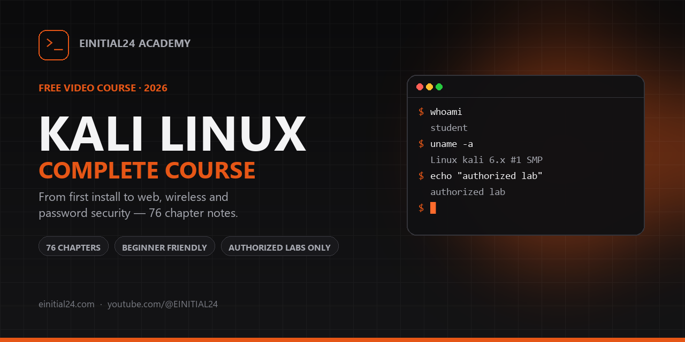
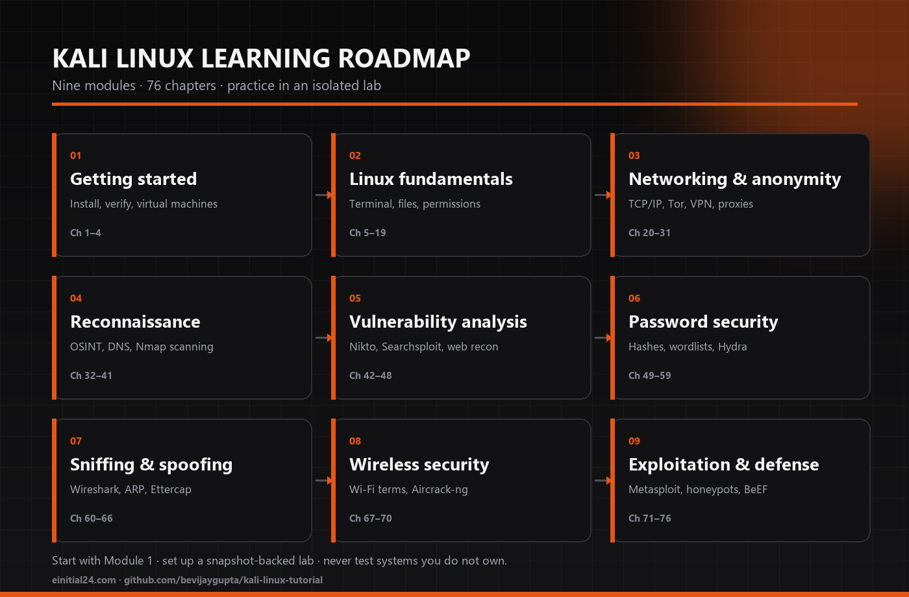

<div align="center">

# Kali Linux Complete Course

**Free, chapter-by-chapter study notes, safe-lab guidance and official documentation for the EINITIAL24 Academy Kali Linux course.**

[](lessons/index.md)
[](lessons/index.md)
[](lessons/index.md)
[](LICENSE)
[](https://bevijaygupta.github.io/kali-linux-tutorial/)
[](https://github.com/bevijaygupta/kali-linux-tutorial/actions/workflows/validate.yml)

[Watch the playlist](https://www.youtube.com/playlist?list=PLYDHfwsEk0RY) · [Lesson index](lessons/index.md) · [Documentation](docs/index.md) · [Resources](resources/index.md) · [Study roadmap](docs/study-roadmap.md)

</div>

## Watch the course

[](https://www.youtube.com/playlist?list=PLYDHfwsEk0RY)

The **Kali Linux Complete Course** is a free video series from **EINITIAL24 ACADEMY**. It moves from installing Kali Linux through Linux fundamentals, networking, reconnaissance, web security, password attacks, traffic analysis, wireless security and exploitation concepts.

This repository is the written companion. It does not re-host videos, publish transcripts or copy full chapter descriptions. Every chapter links to the original YouTube video, and every note is either authored study material or clearly labelled metadata.

- **76 chapters** are mapped in teaching order.
- **47 chapters** were published when the metadata was last checked.
- **29 chapters** were scheduled on YouTube and have no public duration or publish date.
- The playlist displays newest-first; the [lesson index](lessons/index.md) reorders it from Chapter 1 to Chapter 76.

> **Authorized learning only.** Every technique in this course must be practised on systems you own or have explicit written permission to test. Unauthorized access is illegal in most jurisdictions.

## About

This project exists because a video playlist is hard to study from. The videos are linear, the descriptions are brief, and the newest-first order hides the beginning. The repository adds:

- **Original lesson notes** for every chapter: what it covers, the concepts behind it, safe practical context, related chapters and official documentation.
- **A real curriculum** grouped into nine modules, from first install to browser exploitation concepts.
- **A Jekyll site** with lesson search, dark and light themes, breadcrumbs, structured data and a mobile-friendly layout.
- **Safe-lab resources** including a command cheat sheet, a pre-flight checklist, primary-source links and a glossary.
- **Python automation** that refreshes playlist metadata, regenerates pages, builds the search index and validates links and safety notices.
- **GitHub Actions** for validation, scheduled metadata updates and Pages deployment.

The videos remain on YouTube and belong to EINITIAL24 ACADEMY. The repository is an independent study layer, not an official mirror.

### What this repository is not

- It is not a transcript archive.
- It is not a collection of ready-to-run attacks against real systems.
- It does not invent titles, durations, publish dates, ratings, view counts or commands.
- It does not claim search rankings, traffic or endorsements.
- It is not affiliated with OffSec or the Kali Linux project.

## Learning outcomes

After working through the published chapters and the companion guides, you should be able to:

1. Install Kali Linux safely in a virtual machine and verify the ISO source.
2. Navigate the Linux file system, manage permissions and reason about users and processes.
3. Explain IP addresses, ports, DNS, HTTP, NAT, proxies, VPNs and Tor without confusing them with authorization.
4. Perform scoped reconnaissance with `dig`, `whois`, Nmap and web fingerprinting tools.
5. Interpret scan output and turn it into defensible findings rather than a list of scary ports.
6. Explain XSS, SQL injection and the OWASP Top 10, and test them only in deliberately vulnerable labs.
7. Describe how password attacks work, why hashing and salting matter, and how to defend accounts.
8. Capture and read network traffic with Wireshark and `tcpdump` on networks you own.
9. Explain wireless security concepts, monitor mode and the legal limits of radio testing.
10. Describe Metasploit, buffer overflows, honeypots and browser exploitation at a conceptual level.
11. Build a repeatable lab routine with scope, snapshots, isolation checks and cleanup.
12. Write notes and reports that separate evidence from assumptions.

## Curriculum

The table follows the teaching order, not the playlist order. YouTube shows the newest chapter first; this repository keeps the original position in `data/playlist.json`.

<p align="center">
  
</p>

<!-- CURRICULUM:START -->
The table follows the teaching order, not the playlist order. YouTube shows the newest chapter first; this repository keeps the original position in `data/playlist.json`. **76 chapters** are listed: **0 published**, **76 scheduled**.

### Module 1: Getting Started with Kali Linux

| Lesson | Topic | Learning Description | Watch Tutorial |
| ---: | --- | --- | --- |
| [Lesson 1](lessons/lesson-001.md) | Why Use Kali Linux? Kali vs Ubuntu for Ethical Hacking | What Kali Linux is and how it relates to BackTrack Linux and Debian | Scheduled — notes ready |
| [Lesson 2](lessons/lesson-002.md) | Linux Is NOT Unix? Unix vs Linux Explained for Beginners | What Unix is and how it started at Bell Labs in 1969 | Scheduled — notes ready |
| [Lesson 3](lessons/lesson-003.md) | How to Download Kali Linux Safely (Avoid Fake ISOs) | Why unofficial Kali downloads are dangerous | Scheduled — notes ready |
| [Lesson 4](lessons/lesson-004.md) | How to Install VirtualBox (Windows, Mac, Linux) + Best Settings | Why a virtual machine is the right place to run Kali Linux as a beginner | Scheduled — notes ready |

### Module 2: Linux Fundamentals for Ethical Hackers

| Lesson | Topic | Learning Description | Watch Tutorial |
| ---: | --- | --- | --- |
| [Lesson 5](lessons/lesson-005.md) | Linux Terminal for Beginners: Don't Be Afraid of It | Why ethical hackers work from the terminal | Scheduled — notes ready |
| [Lesson 6](lessons/lesson-006.md) | 22 Essential Linux Commands for Beginners (Kali Linux) | Navigate the file system with pwd, ls and cd | Scheduled — notes ready |
| [Lesson 7](lessons/lesson-007.md) | Linux ls Command Explained: ls -l, ls -a, ls -lh (Beginners) | What ls does and when to use each common flag | Scheduled — notes ready |
| [Lesson 8](lessons/lesson-008.md) | Linux cd Command Explained: cd .., cd ~, cd - (Beginners) | How cd moves between directories | Scheduled — notes ready |
| [Lesson 9](lessons/lesson-009.md) | Linux rm Command: How to Delete Files Safely (rm -rf Explained) | How to create single and nested directories with mkdir | Scheduled — notes ready |
| [Lesson 10](lessons/lesson-010.md) | Linux cp Command: How to Copy Files and Folders (cp -r Explained) | How to copy files and directories with cp | Scheduled — notes ready |
| [Lesson 11](lessons/lesson-011.md) | How to Find Files in Linux Fast: locate, find, updatedb | How to find files by name with locate | Scheduled — notes ready |
| [Lesson 12](lessons/lesson-012.md) | Linux sort Command Explained: sort -n, -r, -k, -u (Beginners) | Why default sort is lexicographic rather than numeric | Scheduled — notes ready |
| [Lesson 13](lessons/lesson-013.md) | How to Zip and Unzip Files in Linux (zip -r, unzip -d) | How to compress one or more files with zip | Scheduled — notes ready |
| [Lesson 14](lessons/lesson-014.md) | Linux history Command: View, Reuse and Clear (+ whereis) | How to view your shell command history | Scheduled — notes ready |
| [Lesson 15](lessons/lesson-015.md) | How to Create a User in Linux: adduser, passwd, su Explained | How to create a user account with adduser | Scheduled — notes ready |
| [Lesson 16](lessons/lesson-016.md) | chmod Explained: Linux File Permissions (755, 777, +x) | How to read the ten-character permission string | Scheduled — notes ready |
| [Lesson 17](lessons/lesson-017.md) | chmod u+x, g-w, o=r Explained: Symbolic Permissions in Linux | How to read a permission string character by character | Scheduled — notes ready |
| [Lesson 18](lessons/lesson-018.md) | Permission Denied in Linux? How to Fix File & Folder Permissions | How to grant read, write and execute permissions on files | Scheduled — notes ready |
| [Lesson 19](lessons/lesson-019.md) | Linux Terminal Shortcuts: Ctrl+R, Ctrl+C, Tab and More (Beginners) | How to auto-complete commands and filenames with Tab | Scheduled — notes ready |

### Module 3: Networking, Anonymity & Traffic Routing

| Lesson | Topic | Learning Description | Watch Tutorial |
| ---: | --- | --- | --- |
| [Lesson 20](lessons/lesson-020.md) | Is Kali Linux Anonymous? Tor vs VPN vs Proxy Explained | What anonymity means in cybersecurity | Scheduled — notes ready |
| [Lesson 21](lessons/lesson-021.md) | Proxy Server Explained: How It Hides Your IP (And What It Can't) | What a proxy is and how a request travels through it | Scheduled — notes ready |
| [Lesson 22](lessons/lesson-022.md) | AnonSurf on Kali Linux: Route Your Traffic Through Tor (Setup) | What git clone does and how to download a tool from GitHub | Scheduled — notes ready |
| [Lesson 23](lessons/lesson-023.md) | What Is a VPN? How It Works vs Proxy vs Tor (Beginners) | What a virtual private network is | Scheduled — notes ready |
| [Lesson 24](lessons/lesson-024.md) | How to Use OpenVPN on Kali Linux (.ovpn Setup, Step by Step) | What to check before choosing a VPN service | Scheduled — notes ready |
| [Lesson 25](lessons/lesson-025.md) | Is the Dark Web Illegal? How Tor Really Works (Beginners) | What Tor is and how traffic passes through several relays | Scheduled — notes ready |
| [Lesson 26](lessons/lesson-026.md) | How to Host a .onion Website on Tor (XAMPP + Kali Linux Lab) | What domains and servers do | Scheduled — notes ready |
| [Lesson 27](lessons/lesson-027.md) | How Tor Works: Why No One Can See Both Who You Are and Where You Go | The problem Tor was designed to solve | Scheduled — notes ready |
| [Lesson 28](lessons/lesson-028.md) | Proxychains in Kali Linux: Route Any Tool Through Tor (Setup) | What Proxychains is and how traffic flows through its chain | Scheduled — notes ready |
| [Lesson 29](lessons/lesson-029.md) | Tor + Proxychains in Kali Linux: Do It Right (Step by Step) | How Tor and Proxychains fit together in practice | Scheduled — notes ready |
| [Lesson 30](lessons/lesson-030.md) | Change Your MAC Address in Kali Linux (macchanger Tutorial) | What a MAC address is and how it differs from an IP address | Scheduled — notes ready |
| [Lesson 31](lessons/lesson-031.md) | Macchanger Commands Explained: Every Option in Kali Linux | How to display the current and permanent MAC address | Scheduled — notes ready |

### Module 4: Reconnaissance & Network Scanning

| Lesson | Topic | Learning Description | Watch Tutorial |
| ---: | --- | --- | --- |
| [Lesson 32](lessons/lesson-032.md) | What Is Footprinting? First Step of Ethical Hacking Explained | What footprinting is and where it fits in a penetration test | Scheduled — notes ready |
| [Lesson 33](lessons/lesson-033.md) | DNS Enumeration in Kali Linux: dig, nslookup & dnsenum | What DNS enumeration is and why it matters in reconnaissance | Scheduled — notes ready |
| [Lesson 34](lessons/lesson-034.md) | Dnsenum Tutorial: Find Subdomains Automatically in Kali Linux | How Dnsenum automates DNS enumeration | Scheduled — notes ready |
| [Lesson 35](lessons/lesson-035.md) | DNSmap Tutorial: Find Subdomains with Wordlists in Kali Linux | How DNSmap uses wordlists to enumerate subdomains | Scheduled — notes ready |
| [Lesson 36](lessons/lesson-036.md) | DNStracer Tutorial: Trace DNS Resolution in Kali Linux | What DNStracer does differently from subdomain discovery tools | Scheduled — notes ready |
| [Lesson 37](lessons/lesson-037.md) | Nmap for Beginners: Check Your Network First (ifconfig, route -n) | Why understanding your own network comes before scanning | Scheduled — notes ready |
| [Lesson 38](lessons/lesson-038.md) | Nmap Scan Types Explained: -sS vs -sT vs -sU (Kali Linux Lab) | How to write a basic Nmap command for one host | Scheduled — notes ready |
| [Lesson 39](lessons/lesson-039.md) | Nmap Scans Explained: ACK, FIN, Xmas, -A and NSE (Kali Lab) | What Nmap sends and how it decides a port is open, closed or filtered | Scheduled — notes ready |
| [Lesson 40](lessons/lesson-040.md) | Searchsploit Tutorial: Find Exploits for Nmap Results (Kali Lab) | What Searchsploit and Exploit-DB are | Scheduled — notes ready |
| [Lesson 41](lessons/lesson-041.md) | WhatWeb, Whois and Dirb in Kali Linux: Recon a Website (Lab) | What website footprinting is and why it precedes testing | Scheduled — notes ready |

### Module 5: Web Application & Vulnerability Analysis

| Lesson | Topic | Learning Description | Watch Tutorial |
| ---: | --- | --- | --- |
| [Lesson 42](lessons/lesson-042.md) | Nikto Tutorial: Scan a Web Server for Vulnerabilities (Kali Lab) | What a Nikto scan can and cannot tell you | Scheduled — notes ready |
| [Lesson 43](lessons/lesson-043.md) | Cross-Site Scripting (XSS) for Beginners: How It Works and How to Stop It | What cross-site scripting is and why it happens | Scheduled — notes ready |
| [Lesson 44](lessons/lesson-044.md) | RedHawk Tutorial: All-in-One Website Recon Tool (Kali Lab) | What RedHawk bundles into one reconnaissance workflow | Scheduled — notes ready |
| [Lesson 45](lessons/lesson-045.md) | Linux Security Audit with Lynis: Find Weak Spots in Your System | What a Linux security audit evaluates | Scheduled — notes ready |
| [Lesson 46](lessons/lesson-046.md) | SQLMap Tutorial: Test SQL Injection in a Safe Lab (DVWA + Kali) | What SQL injection is and why it happens | Scheduled — notes ready |
| [Lesson 47](lessons/lesson-047.md) | jSQL Injection Tutorial: SQL Injection with a GUI (Safe Lab) | What jSQL Injection is and how it differs from SQLMap | Scheduled — notes ready |
| [Lesson 48](lessons/lesson-048.md) | sqlsus Tutorial: MySQL Injection Tool in Kali Linux (Safe Lab) | What sqlsus is and how it differs from SQLMap and jSQL | Scheduled — notes ready |

### Module 6: Password Attacks & Hash Cracking

| Lesson | Topic | Learning Description | Watch Tutorial |
| ---: | --- | --- | --- |
| [Lesson 49](lessons/lesson-049.md) | What is a Password Attack? Types Explained | What a password attack is and why credentials remain a common target | Scheduled — notes ready |
| [Lesson 50](lessons/lesson-050.md) | What is Hashing? Explained for Beginners | What a hash function is and how hashing works | Scheduled — notes ready |
| [Lesson 51](lessons/lesson-051.md) | Hash-Identifier Tutorial: Find Out What Hash Type You Have | Why hash identification comes before cracking | Scheduled — notes ready |
| [Lesson 52](lessons/lesson-052.md) | Password & Hash Cracking Tutorial (Hands-On) | The end-to-end password and hash cracking workflow | Scheduled — notes ready |
| [Lesson 53](lessons/lesson-053.md) | CEWL Tutorial: Build Custom Wordlists from Websites | Why target-specific wordlists can outperform generic lists | Scheduled — notes ready |
| [Lesson 54](lessons/lesson-054.md) | Crunch Tutorial: Generate Wordlists with Custom Patterns | What Crunch is and how it differs from CEWL | Scheduled — notes ready |
| [Lesson 55](lessons/lesson-055.md) | How to Crack Passwords Offline Using John the Ripper | What John the Ripper is and why it is used offline | Scheduled — notes ready |
| [Lesson 56](lessons/lesson-056.md) | How to Extract & Crack SAM and Shadow File Hashes | Where Windows stores password hashes and how SAM is structured | Scheduled — notes ready |
| [Lesson 57](lessons/lesson-057.md) | How to Crack RAR & ZIP File Passwords | Why password-protected files require hash extraction first | Scheduled — notes ready |
| [Lesson 58](lessons/lesson-058.md) | THC Hydra Tutorial for Beginners (Online Password Attacks) | How online attacks differ from offline cracking | Scheduled — notes ready |
| [Lesson 59](lessons/lesson-059.md) | Medusa Tutorial: Online Password Brute Forcing | What Medusa is and how it compares with Hydra | Scheduled — notes ready |

### Module 7: Sniffing, Spoofing & Traffic Analysis

| Lesson | Topic | Learning Description | Watch Tutorial |
| ---: | --- | --- | --- |
| [Lesson 60](lessons/lesson-060.md) | What is Sniffing and Spoofing in Ethical Hacking? | What network sniffing is and what it captures | Scheduled — notes ready |
| [Lesson 61](lessons/lesson-061.md) | How to Use Wireshark for Network Sniffing | What Wireshark is and why it is the standard packet analyser | Scheduled — notes ready |
| [Lesson 62](lessons/lesson-062.md) | How to Capture Network Packets Using Wireshark (Practical Guide) | Capture filters versus display filters | Scheduled — notes ready |
| [Lesson 63](lessons/lesson-063.md) | How Wireshark Captures Packets From Another Machine (Remote Sniffing Explained) | Why switched networks limit what Wireshark can see | Scheduled — notes ready |
| [Lesson 64](lessons/lesson-064.md) | What Is a Spoofing Attack? ARP, DNS & IP Spoofing Explained | What spoofing means at the network and identity level | Scheduled — notes ready |
| [Lesson 65](lessons/lesson-065.md) | DNS Spoofing Attack Explained & Demonstrated | How normal DNS resolution works | Scheduled — notes ready |
| [Lesson 66](lessons/lesson-066.md) | How to Configure Ettercap on Kali Linux (Step-by-Step Setup) | What Ettercap is and where it fits in a test | Scheduled — notes ready |

### Module 8: Wireless Network Security

| Lesson | Topic | Learning Description | Watch Tutorial |
| ---: | --- | --- | --- |
| [Lesson 67](lessons/lesson-067.md) | WiFi Hacking Basics: Important Terms Explained Before You Start | The difference between SSID and BSSID | Scheduled — notes ready |
| [Lesson 68](lessons/lesson-068.md) | How to Hack WEP WiFi Networks Using Aircrack-ng (Step-by-Step) | Why WEP is fundamentally insecure | Scheduled — notes ready |
| [Lesson 69](lessons/lesson-069.md) | How to Crack WPA/WPA2 WiFi Passwords Using Aircrack-ng | Why WPA/WPA2 resists the WEP approach | Scheduled — notes ready |
| [Lesson 70](lessons/lesson-070.md) | Fern WiFi Cracker Tutorial — GUI-Based WEP/WPA2 Attacks | What Fern WiFi Cracker is and how it relates to Aircrack-ng | Scheduled — notes ready |

### Module 9: Exploitation, Honeypots & Advanced Topics

| Lesson | Topic | Learning Description | Watch Tutorial |
| ---: | --- | --- | --- |
| [Lesson 71](lessons/lesson-071.md) | What Is Metasploit? Beginner's Guide to the Metasploit Framework | What Metasploit is and where it fits in a penetration test | Scheduled — notes ready |
| [Lesson 72](lessons/lesson-072.md) | How to Exploit a Buffer Overflow Vulnerability with Metasploit | What a buffer overflow is at a conceptual level | Scheduled — notes ready |
| [Lesson 73](lessons/lesson-073.md) | Honeypots Explained — How Security Teams Trap Attackers | What a honeypot is and how it differs from production systems | Scheduled — notes ready |
| [Lesson 74](lessons/lesson-074.md) | Pentbox Tutorial — Setting Up a Honeypot with Pentbox | What Pentbox is and which utilities it bundles | Scheduled — notes ready |
| [Lesson 75](lessons/lesson-075.md) | Browser Exploitation Attack Using Metasploit (BeEF Framework Demo) | What browser exploitation is and how it differs from network exploitation | Scheduled — notes ready |
| [Lesson 76](lessons/lesson-076.md) | How to Perform an Attack Using BeEF (Hooked Browser Modules Explained) | How to navigate the BeEF control panel and browser details | Scheduled — notes ready |
<!-- CURRICULUM:END -->

## Study roadmap

The full eight-week plan, including weekly deliverables and review checkpoints, is in the [study roadmap](docs/study-roadmap.md). This is the short version:

| Week | Focus | Chapters | Deliverable |
| ---: | --- | --- | --- |
| 1 | Install and orient | 1–4 | Verified ISO, working VM, clean snapshot |
| 2 | Linux fundamentals | 5–19 | Permission and user exercises completed |
| 3 | Networking and anonymity | 20–31 | Traffic path diagram; proxy/VPN/Tor comparison |
| 4 | Reconnaissance | 32–41 | Scoped Nmap and DNS notes for a lab target |
| 5 | Web and vulnerability analysis | 42–48 | DVWA or Juice Shop findings with evidence |
| 6 | Passwords and hashing | 49–59 | Lab hash cracking notes and defence checklist |
| 7 | Sniffing, spoofing and wireless | 60–70 | Packet capture analysis; own-network wireless plan |
| 8 | Exploitation concepts and review | 71–76 | Concept map, glossary review and portfolio write-up |

Scheduled chapters are marked on their lesson pages. Add them to the matching week when they are released instead of inventing notes in advance.

## Documentation

The documentation set explains the concepts that span several chapters. Start with the overview, then use the guide that matches your current module.

| Guide | Use it when |
| --- | --- |
| [Documentation overview](docs/index.md) | You want the map of the whole documentation set |
| [Getting started](docs/getting-started.md) | You are new and need a study plan |
| [Installation](docs/installation.md) | You are downloading or installing Kali |
| [Lab setup](docs/lab-setup.md) | You need an isolated, snapshot-backed practice environment |
| [Linux fundamentals](docs/linux-fundamentals.md) | Paths, permissions, users or processes confuse you |
| [Networking basics](docs/networking-basics.md) | Addresses, ports, DNS or traffic paths are unclear |
| [Reconnaissance](docs/reconnaissance.md) | You are starting OSINT, DNS enumeration or Nmap |
| [Vulnerability analysis](docs/vulnerability-analysis.md) | You have scan output and need to interpret it |
| [Exploitation basics](docs/exploitation-basics.md) | You are opening Metasploit for the first time |
| [Password attacks](docs/password-attacks.md) | Hashes, wordlists, Hydra or Medusa are new |
| [Wireless security](docs/wireless-security.md) | You are studying Wi-Fi security and radio limits |
| [Web application security](docs/web-application-security.md) | You are testing a deliberately vulnerable app |
| [Study roadmap](docs/study-roadmap.md) | You need a week-by-week schedule |

## Resources

| Resource | What it gives you |
| --- | --- |
| [Command cheat sheet](resources/cheat-sheet.md) | Linux, networking, recon, web, password and wireless syntax with safety notes |
| [Lab checklist](resources/lab-checklist.md) | Pre-flight, in-session and cleanup checks, plus a scope template |
| [Official links](resources/official-links.md) | Primary documentation, legal references and practice platforms |
| [Glossary](resources/glossary.md) | Plain-language definitions from ARP to zero-day |

## Repository structure

```text
kali-linux-tutorial/
├── _config.yml                 # Jekyll site configuration
├── _data/                      # Generated course data for the site
├── _includes/                  # Head, header, footer, schema, breadcrumbs
├── _layouts/                   # default, page, doc and lesson layouts
├── assets/
│   ├── css/main.css            # Dark/light theme, orange #E65616 accent
│   ├── data/                   # Generated lesson search index
│   ├── images/                 # Logo, banner, social preview, roadmap
│   └── js/                     # Theme, search, lesson player and TOC
├── data/
│   ├── playlist.json           # Verified YouTube metadata and playlist order
│   ├── playlist-metadata.json  # Counts, source and extraction date
│   └── curriculum.json         # Authored notes for every chapter
├── docs/                       # 13 concept and workflow guides
├── lessons/                    # 76 lesson pages plus the course index
├── resources/                  # Cheat sheet, checklist, links, glossary
├── scripts/
│   ├── fetch_playlist.py       # YouTube API or public-page metadata refresh
│   ├── generate_lesson_pages.py
│   ├── generate_content.py     # Search index, llms.txt, _data/course.json
│   ├── generate_sitemap.py
│   ├── validate_links.py
│   └── update_repository.py    # Full local/CI pipeline
├── templates/                  # Lesson, docs and resource templates
├── .github/workflows/          # Validate, update playlist, deploy Pages
├── index.md                    # Site home page
├── sitemap.xml                 # Generated sitemap
├── robots.txt
├── 404.md
├── llms.txt                    # Generated machine-readable site summary
├── requirements.txt
├── package.json
└── .env.example
```

## Automation and local development

The Python scripts use only the Python 3.11+ standard library. The optional API keys enable the official YouTube API and AI-assisted draft summaries; without them the pipeline still works in metadata-only mode.

### Local setup

```bash
python -m venv .venv
# Windows:
.venv\Scripts\activate
# macOS/Linux:
source .venv/bin/activate

pip install -r requirements.txt
```

### Regenerate and validate

```bash
# Use existing data, regenerate pages, search index and sitemap, then validate
python scripts/update_repository.py --skip-fetch

# Or run each step
python scripts/generate_lesson_pages.py
python scripts/generate_content.py
python scripts/generate_sitemap.py
python scripts/validate_links.py --strict

# Verify committed output is current (used by CI)
python scripts/generate_lesson_pages.py --check
python scripts/generate_content.py --check
python scripts/generate_sitemap.py --check
```

`update_repository.py` refreshes the playlist when `--skip-fetch` is omitted. If YouTube adds a chapter that is not in `data/curriculum.json`, the script writes `data/curriculum-drafts.json` for review and generates a clearly labelled metadata-only page instead of inventing notes.

### Refresh metadata from YouTube

```bash
# Public pages, no key required
python scripts/fetch_playlist.py

# Official YouTube Data API v3
YOUTUBE_API_KEY=your-key python scripts/fetch_playlist.py

# Optional AI-assisted draft summaries, never published automatically
python scripts/update_repository.py --enrich
```

Never commit real keys. Copy `.env.example` to `.env` for local use — `fetch_playlist.py` and `update_repository.py` load it automatically, and variables already exported in your shell take precedence. Add `YOUTUBE_API_KEY`, `OPENAI_API_KEY` or `GEMINI_API_KEY` as GitHub Actions secrets for the weekly workflow.

### Preview the site

The site is built by Jekyll. With Ruby and Bundler installed:

```bash
bundle install
bundle exec jekyll serve
```

The preview follows `baseurl: /kali-linux-tutorial` from `_config.yml`, so open `http://127.0.0.1:4000/kali-linux-tutorial/`. To preview at the root, run `bundle exec jekyll serve --baseurl ""`.

GitHub Pages deployment is handled by `.github/workflows/pages.yml`. In the repository settings, set **Pages → Build and deployment → Source** to **GitHub Actions**.

### Weekly playlist updates

`.github/workflows/update-playlist.yml` runs every Monday and can be started manually. It:

1. refreshes `data/playlist.json` and `data/playlist-metadata.json`;
2. writes a review-only draft for any chapter without authored notes;
3. regenerates lesson pages, the search index, `llms.txt` and the sitemap;
4. validates the result;
5. opens a pull request on `automation/playlist-update`.

It never pushes directly to `main`. If a secret is missing, the relevant step is skipped or the public-page fallback is used, and the workflow says so in its summary.

## Metadata and content policy

- Titles, descriptions, durations and dates come from YouTube metadata or are recorded as `null`.
- Published chapters receive a `VideoObject` only when the video ID, upload date and duration are verified.
- Scheduled chapters never receive a fabricated date, duration, rating or `VideoObject`.
- Lesson notes are original explanations, not transcripts.
- Commands are included for study in isolated labs; destructive options are marked.
- No video files, thumbnails beyond hotlinked YouTube metadata, credential dumps or personal data are stored here.
- If a fact cannot be verified, it is omitted or labelled as unverified rather than guessed.

## FAQ

### Is the course really free?

Yes. The videos are free on YouTube and the written notes are free to read. There is no account, paywall or upsell in this repository.

### Do I need Linux experience before starting?

No. Module 2 starts from the terminal and assumes no prior experience. If you already know Linux, you can move faster through Chapters 5–19, but do not skip the permission and process exercises.

### Are the lesson pages transcripts of the videos?

No. They are original study notes based on the chapter topic and official metadata. The repository does not publish transcripts, and it does not copy full YouTube descriptions.

### Why do some chapters say “scheduled”?

The channel has announced future chapters. Their pages are labelled as scheduled, use only the official description for context, and deliberately leave the publish date and duration as `null`. They are replaced with fuller notes after release and review.

### Can I practise on any website or network?

No. Test only systems you own or have explicit written permission to test. Use an isolated lab, DVWA, OWASP Juice Shop or a platform that provides scoped targets. Unauthorized access is illegal.

### Do I need a separate computer for the lab?

Usually not. A virtual machine with host-only networking, a snapshot and a disposable target VM is enough for most chapters. Wireless exercises need compatible hardware and are limited to networks you own.

### Why is the playlist order different from the lesson numbers?

YouTube displays the newest video first, so playlist position 1 is the most recent chapter. Lesson numbers follow the intended teaching order, with Chapter 1 at `lesson-001`. The original playlist position is preserved on every lesson page and in `data/playlist.json`.

### How often is the metadata updated?

A GitHub Actions workflow checks the playlist weekly and opens a pull request when something changes. The pull request is reviewed before merge; the workflow never writes to `main` directly.

### Can I reuse the notes or the code?

The code is MIT licensed and the written content is CC BY 4.0. You may reuse and adapt them with attribution. Video titles, descriptions and thumbnails remain the property of EINITIAL24 ACADEMY, and the videos are not covered by those licences.

### How do I report a mistake or a broken link?

Open an issue using the bug report template, or send a pull request with the correction and the source that supports it. For security concerns about the repository itself, follow [SECURITY.md](SECURITY.md) instead of opening a public issue.

## About EINITIAL24 Academy

**EINITIAL24 Academy** publishes free, practical cybersecurity education for beginners.

- Website: [einitial24.com](https://einitial24.com/)
- YouTube: [@EINITIAL24](https://www.youtube.com/@EINITIAL24)
- Course playlist: [Kali Linux Complete Course](https://www.youtube.com/playlist?list=PLYDHfwsEk0RY)

The course and channel are the source of the video material. This repository is a community-style study companion maintained alongside it. Kali Linux is a trademark of OffSec. EINITIAL24 Academy and this repository are not affiliated with OffSec.

## Contributing and licence

Contributions are welcome when they improve accuracy, safety or accessibility. Read [CONTRIBUTING.md](CONTRIBUTING.md) and [CODE_OF_CONDUCT.md](CODE_OF_CONDUCT.md) before opening a pull request. Please do not submit transcripts, re-hosted videos, real credentials, target lists or unverified claims.

- **Code:** MIT, see [LICENSE](LICENSE).
- **Written content:** CC BY 4.0, see [LICENSE](LICENSE).
- **Video content and thumbnails:** property of EINITIAL24 ACADEMY; linked, not re-licensed.

## Start learning

Ready to begin? The first chapter explains why Kali exists and who it is for.

**[Start with Chapter 1 →](lessons/lesson-001.md)** · **[Open the lab checklist →](resources/lab-checklist.md)** · **[Watch the playlist →](https://www.youtube.com/playlist?list=PLYDHfwsEk0RY)**

If this repository helps your study, star it so other learners can find it. For corrections, open an issue with a source rather than a guess.
